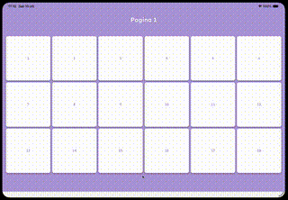

# flutter-flip-animation

Creating a "Newspaper Flip page-turn" effect within a reusable service, allowing any page, given a list of widgets, to flip through them exactly like a newspaper (Flipboard-style).

## Demo

<p align="center">
    
    <br>
    <em>Interactive demonstration of the newspaper page-flip effect running on an iPad Pro 11" emulator, driven by smooth drag gestures and custom 3D perspective transformations.</em>
</p>

### File created:

`lib/services/local/page_flip/page_flip_service.dart`

### How the effect works

A single `AnimationController` with a continuous value:

- `0.0` = page 0
- `1.0` = page 1
- `0.5` = halfway through the flip between the two
- `currentIndex = floor(value)`
- `nextIndex = ceil(value)`
- `localProgress = value - currentIndex`

During the flip, the following layers are stacked:

1. `pages[nextIndex]` underneath (the page being revealed)
2. Static left half of `pages[currentIndex]`
   - `HalfClipper(rightHalf: false)`
3. A rotating half on the Y axis (`rotateY(pi * localProgress)`, perspective `0.001`)
   - `localProgress <= 0.5` => front face: right half of the current page, with an increasing black shadow;
   - `localProgress > 0.5` => back face: left half of the next page, mirrored (`rotateY(pi)`), with a decreasing shadow.

If `currentIndex == nextIndex`, the page is displayed directly without a stack.

### Service API

| Method                                                 | Usage                                                                                                                                        |
| ------------------------------------------------------ | -------------------------------------------------------------------------------------------------------------------------------------------- |
| `PageFlipService.createController(vsync, initialPage)` | Creates the controller (`upperBound: infinity`, clamping is handled in the service).                                                         |
| `buildFlip(pages: [...])`                              | Widget that renders the flip effect (encapsulates `AnimatedBuilder`).                                                                        |
| `onDragUpdate(details, screenWidth, pageCount)`        | From `onHorizontalDragUpdate`: updates the controller value.                                                                                 |
| `onDragEnd(details, pageCount)`                        | From `onHorizontalDragEnd`: calculates target page (position + velocity ±500), animates over 300ms `easeOut`, and returns the reached index. |
| `resolveTargetPage(details, pageCount)`                | Only computes the target page, without animating.                                                                                            |
| `animateToPage(target, pageCount)`                     | Programmatic navigation. Returns `null` if already at the target page.                                                                       |
| `jumpToPage(page, pageCount)`                          | Jump without animation.                                                                                                                      |
| `currentPage`                                          | The page closest to the current controller value.                                                                                            |

Configurable constructor parameters: `velocityThreshold`, `snapDuration`, `snapCurve`, `perspective`, `shadowOpacity`.

> The service does not own the controller: the page creates and disposes of it (requires the `State`'s `TickerProvider`).

### How to use it in a page

```dart
class _MyPageState extends State<MyPage> with SingleTickerProviderStateMixin {
  late final AnimationController _controller;
  late final PageFlipService _flip;

  @override
  void initState() {
    super.initState();
    _controller = PageFlipService.createController(vsync: this, initialPage: 0);
    _flip = PageFlipService(controller: _controller);
  }

  @override
  void dispose() {
    _controller.dispose();
    super.dispose();
  }

  @override
  Widget build(BuildContext context) {
    final pages = <Widget>[PageA(), PageB(), PageC()];

    return GestureDetector(
      onHorizontalDragUpdate: (d) => _flip.onDragUpdate(
        d,
        screenWidth: MediaQuery.sizeOf(context).width,
        pageCount: pages.length,
      ),
      onHorizontalDragEnd: (d) async {
        final page = await _flip.onDragEnd(d, pageCount: pages.length);
        if (!mounted) return;
        // tracking, tutorial, etc.
      },
      child: _flip.buildFlip(pages: pages),
    );
  }
}
```

### Final notes

- Behavior: threshold (500 px/s), duration (300ms), curve, perspective, and shadow opacity.
- Clamp: the service caps the index at `pageCount - 1`.
- Empty pages: `buildFlip` returns `SizedBox.shrink()` if the list is empty.
- Dependency: `misc/half_clipper.dart`.
- Performance: `pages` are instantiated by the parent page on every build; during a flip, the same page appears multiple times in the stack (for both halves). If you notice excessive rebuilds with state-heavy widgets, consider using `GlobalKey`/`AutomaticKeepAlive`.
- `withOpacity` is deprecated in recent Flutter versions: replace it with `withValues(alpha: ...)` if needed.

### Possible future enhancements

- A PageFlipView`(pages: [...])` wrapper widget that hides the controller and gestures for simpler use cases.
- Support for `onPageChanged` as a service callback.
- Reversed direction support (RTL).
